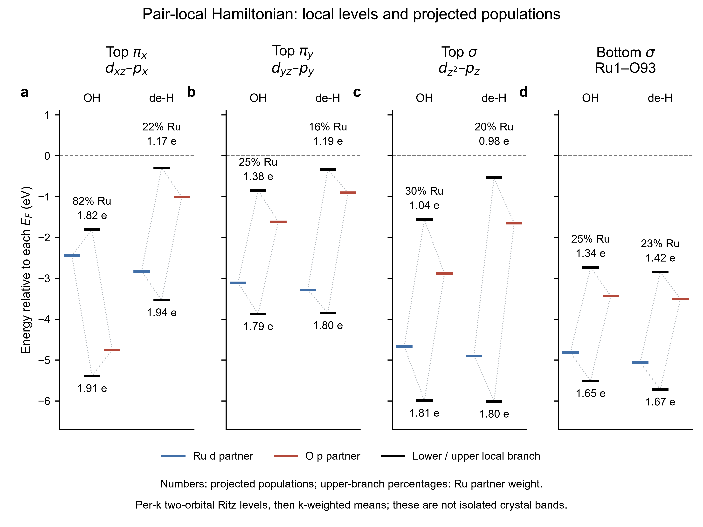

# Orbital Bonding Methods

**Tangtao Chen · TU Berlin**

Version 0.1.0 is archived on Zenodo: [10.5281/zenodo.24119269](https://doi.org/10.5281/zenodo.24119269).

Research software archive for three complementary workflows:

| Directory | Purpose | Small example |
|---|---|---|
| [iao-svd](iao-svd/README.md) | PAW-aware full-cell IAO density construction and pair-resolved SVD coherence channels | Archived O 2s+2p clean Ru–O example with four mathematical channels |
| [qe-orbital-fields](qe-orbital-fields/README.md) | QE 7.5 orbital-selective fields: OFE V1.3 and the separately validated fixed-IAO projector branch | Input generation plus a six-atom fixed-projector example |
| [lobster-local-levels](lobster-local-levels/README.md) | Pair-local two-orbital levels, orbital character and projected populations from LOBSTER matrices | Eight channel/state results and the four-panel energy-level figure |



The methods have different mathematical observables. IAO-SVD quantifies density
coherence; the QE modules apply specified operators self-consistently; the
LOBSTER workflow compresses the projected Hamiltonian into a specified
two-orbital subspace. Their output quantities should retain those definitions.

## Run the included numerical examples

Python 3.12 or newer and [uv](https://docs.astral.sh/uv/) are required for the
Python commands. Each executable Python script declares its own dependencies.
Run commands from the repository root. Create `work/` once before plotting or
writing an individual result file; analysis commands that create their own
output directory require a new, nonexistent output path.

```text
uv run iao-svd/source/principal_density_channels_v2.py --config iao-svd/examples/o2s-clean/config.json --output work/iao-clean
uv run qe-orbital-fields/ofe/tools/ofe_input.py check qe-orbital-fields/ofe/example/ofe.in
uv run lobster-local-levels/plot_levels.py lobster-local-levels/example/source_data.csv work/local_levels
```

The IAO density example is a 49.5 MiB NumPy array. Use Git to upload this repository;
GitHub's browser uploader has a smaller per-file limit. It is numerical research
data, not a wavefunction or a potential file.

Actual QE runs require a Linux/MPI Quantum ESPRESSO 7.5 environment and matching
pseudopotentials. PAW preprocessing requires your own VASP outputs and atomic
template calculations. The LOBSTER plot can be regenerated from the included
CSV; raw-matrix recalculation requires your own matching LOBSTER matrices.

## Evidence and release status

[VALIDATION.md](VALIDATION.md) separates checks performed while preparing this
archive from the historical scientific/software validation records. This is
an initial source archive, not a claim of universality or a newly established
physical mechanism. Citation metadata is in [CITATION.cff](CITATION.cff).

The existing QE GPL notices are retained. No new open-source license has been
chosen for previously unlicensed original code; see [LICENSE](LICENSE) and
[THIRD_PARTY.md](THIRD_PARTY.md) for the exact scope.

## 中文入口

本仓库按 IAO–SVD、定制 QE、LOBSTER 局域能级图分为三个目录。每个目录包含
方法定义、实际代码、单一路径的使用说明和已有算例。作者署名为 Tangtao Chen，
单位 TU Berlin。数值结果保留原定义与适用范围；归档不增加新的机理结论。

目录中的脚本通过相对路径寻找自己的依赖，不包含集群账号、主机设置、调度脚本、
程序二进制或受许可限制的赝势文件。公开发布时应沿用本仓库中的许可边界。
